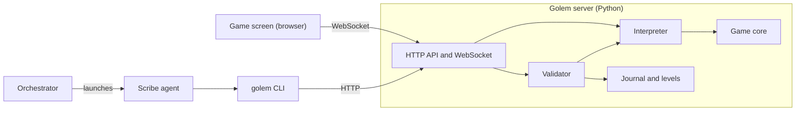
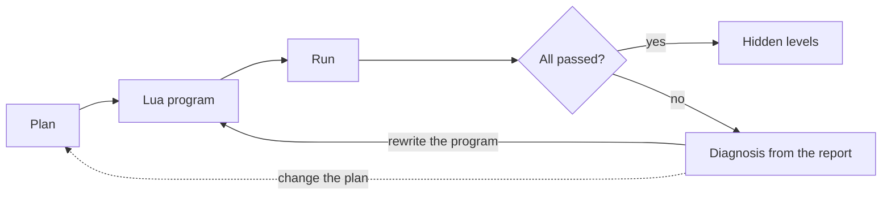

# Golem: an agent that writes a program for itself

2026-11-17 · Vitalii

## Idea

The agent receives a set of Sokoban-style levels and writes a Lua program that drives a Karel-like robot. The agent itself makes no moves during the game: it only writes the program, runs it and reads the run report.

The game does not test the ability to solve a single level. It tests whether the agent can understand from the report why the program failed and rewrite it so that it passes more levels than the previous version.

## Components

The project consists of six components, all built on one game core, so that a human with arrow keys and the agent's program play by the same rules.

| Component | What it does | What to watch for |
| --- | --- | --- |
| Game core | Holds the world state and applies the rules to every move | No graphics, deterministic, can save and restore state |
| Game for a human | Shows the level and lets you drive the robot with arrow keys | The same screen replays recorded program runs |
| Robot language | Gives the program the player's eyes, movement commands and memory for the map | Memory lives apart from the program so the map survives a rewrite |
| Interpreter | Executes the program in the core step by step, counts the budget and stops at breakpoints | Every robot command is a Lua coroutine yield, so a stop is possible after any move |
| Agent | A separate process launched from the shell: writes the program, calls game commands, and at each stop decides whether to continue or rewrite | Watches stop conditions rather than every step, because a model call per move is too slow and too expensive |
| Levels, validator and journal | Runs the program over level sets and stores reports, traces and program versions | Without it there is nothing to measure progress with and nowhere to roll back to |

The interpreter stops on events set by the agent: an error, a deadlock, a `give_up` call, half the budget spent with no box on a goal, or a repeated world state. At a stop the agent receives a snapshot of the robot's memory and its latest actions and has two options: continue, or swap in a new program that starts from the current world state with the same robot memory and the remaining budget. The level never restarts, so every wrong push has a cost.

## Interface between the game and the agent

The project and the robot in the game world are called Golem, and the first agent has its own name, Scribe. The agent is an independent program launched from the shell that sees the game only through server commands. The game server is written in Python; it exposes the same commands as an HTTP API and as a command-line tool, and every response comes back as JSON.

| Command | What it does |
| --- | --- |
| `golem levels` | Lists the training levels |
| `golem run <level> <program>` | Starts the program with the given stop conditions and runs it until the first stop or the end of the level |
| `golem state` | Returns a snapshot: robot memory, latest actions, stop reason, remaining budget |
| `golem continue` | Continues the same program until the next stop |
| `golem swap <program>` | Swaps in a new program from the current world state with the same memory |
| `golem validate <program>` | Runs the program over all levels; for hidden levels it returns only passed or failed |

Isolation has three consequences. The agent can be replaced by another one without changing the game, it physically cannot reach the hidden levels or the world state, and several agents in phase 8 become several processes around one server. A small Python orchestrator launches the agent as a subprocess, enforces the version and time limits and keeps the journal.

## Architecture

Everything that knows the rules and the world state lives in one server, while the game screen and the agent are separate programs that reach it through a single interface.

The screen receives the world state over WebSocket and sends arrow keys, while the agent calls the `golem` tool, which turns commands into HTTP requests. Inside the server both human moves and robot program commands go through the same core, and the validator runs the interpreter over level sets and writes the results to the journal.

## Tech stack

The whole project is written in Python, and the browser is needed only for the game screen.

| Part | Technology | Why |
| --- | --- | --- |
| Game core | Pure Python with no dependencies, tests in pytest | The rules are easy to verify apart from everything else |
| Server | FastAPI with uvicorn, WebSocket for the screen | One process serves both the HTTP API and the live world state |
| golem CLI | Typer and httpx | A thin wrapper over the API that is convenient to call from the shell |
| Robot language | Lua through the lupa library | A ready sandbox and coroutines for step-by-step execution; the decision is still open |
| Game screen | A single HTML page with canvas and JavaScript, no frameworks | Drawing a grid is simple, and pywebview can wrap the page into an app if needed |
| Journal | SQLite for runs and versions, JSON files for traces | Needs no separate database server |
| Levels | Text files in the Sokoban format | Ready-made level sets can be used and edited in any editor |
| Scribe agent | Claude Code in non-interactive mode | Already able to write files and call shell commands |
| Orchestrator | A Python script using subprocess | Launches the agent and enforces version and time limits |

## World and rules

The world is a grid with walls, boxes, goals and one robot, and the rules come from classic Sokoban: the robot pushes one box at a time and cannot pull it. A level is passed when every box stands on a goal.

The robot sees only its own cell and the four neighbouring ones. The program does not receive the full map, so it has to explore the level and assemble the map in its memory before pushing anything.

A level is lost in three cases: the step budget is exhausted, the instruction budget is exhausted, or a box is pushed into a corner with no goal. The simulator is deterministic, so the same program on the same level always gives the same result.

## Robot language

The program is written in Lua and runs in a sandbox where only five robot commands and the ordinary language features are available: variables, loops, functions and tables. The `io`, `os` and `require` modules are disabled.

| Command | What it does | What it returns |
| --- | --- | --- |
| `move(dir)` | Takes a step in direction N, E, S or W; if a box is there and the cell behind it is free, pushes it | `true` or `false` |
| `look(dir)` | Looks at a neighbouring cell | `wall`, `box`, `goal`, `box_on_goal` or `empty` |
| `here()` | Checks the cell under the robot | `goal` or `empty` |
| `boxes_left()` | Counts the boxes not yet on goals | a number |
| `give_up(reason)` | Stops the run when the program itself sees it cannot cope | the reason goes into the report |

The robot's memory is a separate `memory` table kept by the interpreter, so it lives for the whole level and survives a program swap. Every level has a step budget and an instruction budget that the simulator counts through `debug.sethook`, so an infinite loop ends as an entry in the report rather than a hang.

## Agent loop

The agent repeats four steps until the program passes all training levels or the version limit runs out.

An ordinary failure sends the agent back to the program, and the dashed line shows the rarer case when the plan itself has to change.

1. **Plan.** The agent writes down the strategy in words: how to explore the level, how to choose a box and a goal, how to avoid deadlocks.
2. **Program.** The agent turns the plan into Lua code built on the robot commands.
3. **Run.** The simulator executes the program on all training levels and compiles a report.
4. **Validation.** If everything passes, the program goes to the hidden levels; if not, the agent diagnoses the problem from the report and rewrites the program.

## When the agent rewrites the program

The agent changes the program at a stop or after a run, and the depth of the change depends on the problem the report shows. Every version is stored together with the reason for the change so that a rollback is possible.

| Problem in the report | Agent's reaction |
| --- | --- |
| Lua runtime error | Fixes the specific line the error points to |
| Step or instruction budget exhausted | Looks for a loop or a wasteful traversal and changes the search algorithm |
| Box pushed into a deadlock | Adds a deadlock check before every push |
| The program called `give_up` | Reads the reason and adds the case the program could not handle |
| A level that used to pass now fails | Rolls back to the previous version and tries a different fix |
| Several versions in a row with no progress | Goes back to the plan, changes the strategy and writes the program from scratch |

The run report is the agent's only source of knowledge about what happened. For every level it contains the status, the number of steps and instructions, the error text, the robot's last twenty actions and the final map.

## Levels and metrics

Levels are split into training and hidden ones. For training levels the agent gets the full report, and for hidden ones only whether the level was passed, so fitting the program to specific maps will not work.

Difficulty grows in three tiers:

1. One box in an open room, where it is enough to find the box and the goal.
2. Several boxes and corridors, where the order of pushes matters.
3. Levels with traps, where a careless push during exploration loses the level at once.

Progress is measured by four numbers: the share of hidden levels passed, the number of program versions needed to get there, the number of regressions between versions, and the average number of steps per level.

## Implementation phases

Implementation goes in eight phases, and the agent appears only in the sixth: before that every part can be verified by hand, without a model.

| Phase | What we build | Done when |
| --- | --- | --- |
| 1. Game core | World state, Sokoban rules, loading levels from the text format, saving and restoring state | A recorded sequence of moves always produces the same final state |
| 2. Game for a human | Level screen and arrow-key control on top of the core | You pass ten training levels by hand |
| 3. Language and interpreter | Lua sandbox, robot commands, the memory table, budgets, step-by-step execution on coroutines | A hand-written program passes a tier-one level |
| 4. Stops and program swap | Stop conditions, snapshot of memory and latest actions, starting a new program from the current state | A program swapped in by hand mid-level finishes it using the old map |
| 5. Validator and journal | HTTP API and command-line tool, runs over level sets, JSON report, traces, program versions, run replay on the game screen | One command gives a report for all levels, and any run can be replayed |
| 6. Agent | The agent as a separate process that works only through game commands; the plan, program, run, diagnosis loop; an orchestrator with version and time limits | The agent passes the tier-one training levels without hints |
| 7. Experiments | Tier-two and tier-three levels, hidden levels, metrics per version | There is a metrics table showing where the agent stops coping |
| 8. Several agents | Several robots on one level, each with its own agent, program and memory; send and receive commands in the robot language; a shared channel where agents negotiate at stops | Two agents pass a level that a single robot cannot |

Phase 4 is the riskiest, because swapping a program from the current state determines how memory and the interpreter are designed. It is worth testing with a simple prototype right after phase 3, before any polishing.

In phase 8 communication happens at two levels. Robot programs exchange short messages during a move, for example sharing pieces of the map, while the agents at stops agree on who takes which box and who rewrites their program. Levels for this phase must require cooperation, where one robot has to clear the way for another.
