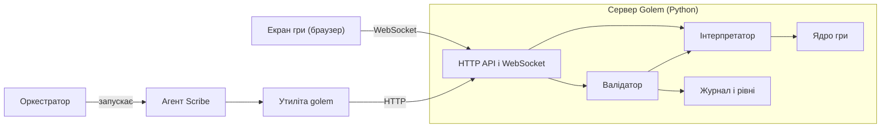
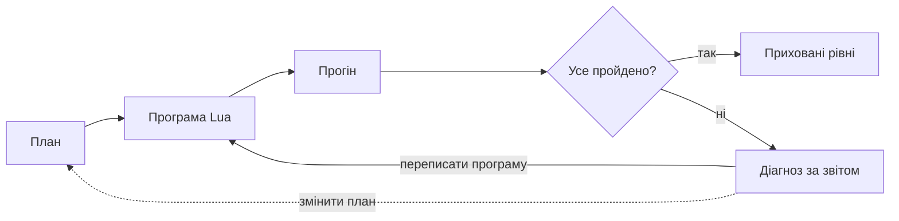

# Golem: агент, що пише програму для себе

2026-11-17 · Vitalii

## Ідея

Агент отримує набір рівнів у стилі Sokoban і пише програму на Lua, яка керує роботом у дусі Karel. Сам агент під час гри ходів не робить: він лише пише програму, запускає її і читає звіт про прогін.

Гра перевіряє не вміння розв'язати один рівень, а здатність агента зрозуміти зі звіту, чому програма не впоралась, і переписати її так, щоб вона проходила більше рівнів, ніж попередня версія.

## Компоненти

Проєкт складається з шести компонентів, і всі вони працюють поверх одного ядра гри, щоб людина зі стрілками і програма агента грали за тими самими правилами.

| Компонент | Що робить | На що звернути увагу |
| --- | --- | --- |
| Ядро гри | Зберігає стан світу і застосовує правила до кожного ходу | Без графіки, детерміноване, вміє зберегти й відновити стан |
| Гра для людини | Показує рівень і дає керувати роботом стрілками | Той самий екран відтворює записані прогони програми |
| Мова робота | Дає програмі очі гравця, команди руху і пам'ять для карти | Пам'ять живе окремо від програми, щоб карта пережила переписування |
| Інтерпретатор | Виконує програму в ядрі по кроках, рахує бюджет і зупиняється на точках переривання | Кожна команда робота є паузою корутини Lua, тому зупинка можлива після будь-якого ходу |
| Агент | Окремий процес, що запускається з шела: пише програму, викликає команди гри, на зупинках вирішує: продовжити чи переписати | Стежить за умовами зупинки, а не за кожним кроком, бо виклик моделі на кожен хід занадто повільний і дорогий |
| Рівні, валідатор і журнал | Проганяє програму по наборах рівнів, зберігає звіти, траси та версії програми | Без нього нема чим виміряти прогрес і нікуди відкочуватись |

Інтерпретатор зупиняється на подіях, які задає агент: помилка, тупик, виклик `give_up`, половина бюджету без жодного ящика на цілі або повтор того самого стану світу. На зупинці агент отримує знімок пам'яті робота та останні дії і має два виходи: продовжити або підставити нову програму, яка стартує з поточного стану світу з тією самою пам'яттю робота і залишком бюджету. Рівень заново не починається, тому кожен хибний поштовх має ціну.

## Інтерфейс між грою та агентом

Проєкт і робот у світі гри називаються Golem, а перший агент має власне ім'я Scribe. Агент є незалежною програмою, яка запускається з шела і бачить гру лише через команди сервера. Сервер гри написано на Python; він віддає ті самі команди як HTTP API і як консольну утиліту, а кожна відповідь приходить у JSON.

| Команда | Що робить |
| --- | --- |
| `golem levels` | Показує список навчальних рівнів |
| `golem run <рівень> <програма>` | Запускає програму із заданими умовами зупинки і виконує її до першої зупинки або кінця рівня |
| `golem state` | Повертає знімок: пам'ять робота, останні дії, причину зупинки, залишок бюджету |
| `golem continue` | Продовжує ту саму програму до наступної зупинки |
| `golem swap <програма>` | Підставляє нову програму з поточного стану світу і з тією самою пам'яттю |
| `golem validate <програма>` | Проганяє програму по всіх рівнях; для прихованих повертає лише «пройдено» чи «ні» |

Ізоляція дає три наслідки. Агента можна замінити іншим без зміни гри, до прихованих рівнів і стану світу він фізично не дістається, а кілька агентів у фазі 8 стають кількома процесами біля одного сервера. Невеликий оркестратор на Python запускає агента як підпроцес, стежить за лімітом версій і часу та веде журнал.

## Архітектура

Усе, що знає правила і стан світу, живе в одному сервері, а екран гри та агент є окремими програмами, які ходять до нього через один інтерфейс.

Екран отримує стан світу через WebSocket і надсилає стрілки, а агент викликає утиліту `golem`, яка перетворює команди на запити HTTP. Усередині сервера і ходи людини, і команди програми робота проходять через те саме ядро, а валідатор запускає інтерпретатор по наборах рівнів і пише результати в журнал.

## Технологічний стек

Увесь проєкт пишеться на Python, а браузер потрібен лише для екрана гри.

| Частина | Технологія | Чому |
| --- | --- | --- |
| Ядро гри | Чистий Python без залежностей, тести на pytest | Правила легко перевірити окремо від усього іншого |
| Сервер | FastAPI з uvicorn, WebSocket для екрана | Один процес віддає і HTTP API, і живий стан світу |
| Утиліта golem | Typer і httpx | Тонка обгортка над API, яку зручно викликати з шела |
| Мова робота | Lua через бібліотеку lupa | Готова пісочниця і корутини для покрокового виконання; рішення ще відкрите |
| Екран гри | Одна сторінка HTML з canvas і JavaScript без фреймворків | Малювати сітку просто, а pywebview за потреби загорне сторінку в застосунок |
| Журнал | SQLite для прогонів і версій, файли JSON для трас | Не потребує окремого сервера бази даних |
| Рівні | Текстові файли у форматі Sokoban | Можна брати готові набори і правити в редакторі |
| Агент Scribe | Claude Code у неінтерактивному режимі | Уже вміє писати файли й викликати команди шела |
| Оркестратор | Скрипт на Python із subprocess | Запускає агента, тримає ліміти версій і часу |

## Світ і правила

Світ є сіткою зі стінами, ящиками, цілями та одним роботом, а правила взято з класичного Sokoban: робот штовхає один ящик за раз і не може його тягнути. Рівень пройдено, коли всі ящики стоять на цілях.

Робот бачить лише свою клітинку і чотири сусідні. Повної карти програма не отримує, тому мусить сама дослідити рівень і зібрати карту у своїй пам'яті, перш ніж щось штовхати.

Рівень вважається програним у трьох випадках: вичерпано бюджет кроків, вичерпано бюджет інструкцій або ящик загнано в кут, де немає цілі. Симулятор детермінований, тож та сама програма на тому самому рівні завжди дає той самий результат.

## Мова робота

Програма пишеться на Lua і виконується в пісочниці, де доступні лише п'ять команд робота та звичайні засоби мови: змінні, цикли, функції й таблиці. Модулі `io`, `os` і `require` вимкнено.

| Команда | Що робить | Що повертає |
| --- | --- | --- |
| `move(dir)` | Робить крок у напрямку N, E, S або W; якщо там ящик і за ним вільно, штовхає його | `true` або `false` |
| `look(dir)` | Дивиться на сусідню клітинку | `wall`, `box`, `goal`, `box_on_goal` або `empty` |
| `here()` | Перевіряє клітинку під роботом | `goal` або `empty` |
| `boxes_left()` | Рахує ящики, які ще не на цілях | число |
| `give_up(reason)` | Зупиняє прогін, коли програма сама бачить, що не впорається | причина потрапляє у звіт |

Пам'ять робота є окремою таблицею `memory`, яку зберігає інтерпретатор, тому вона живе весь рівень і переживає заміну програми. Кожен рівень має бюджет кроків і бюджет інструкцій, який симулятор рахує через `debug.sethook`, тому нескінченний цикл закінчується записом у звіті, а не зависанням.

## Цикл агента

Агент повторює чотири кроки, доки програма не пройде всі навчальні рівні або не вичерпається ліміт версій.

Звичайна невдача повертає агента до програми, а пунктирна лінія показує рідший випадок, коли доводиться міняти сам план.

1. **План.** Агент записує словами стратегію: як досліджувати рівень, як обирати ящик і ціль, як уникати тупиків.
2. **Програма.** Агент перетворює план на код Lua з командами робота.
3. **Прогін.** Симулятор виконує програму на всіх навчальних рівнях і складає звіт.
4. **Валідація.** Якщо все пройдено, програма йде на приховані рівні; якщо ні, агент ставить діагноз за звітом і переписує програму.

## Коли агент переписує програму

Агент змінює програму на точці зупинки або після прогону, і глибина зміни залежить від того, яку проблему показав звіт. Кожна версія зберігається разом із причиною зміни, щоб можна було відкотитись.

| Проблема у звіті | Реакція агента |
| --- | --- |
| Помилка виконання Lua | Точково виправляє рядок, на який вказує помилка |
| Вичерпано бюджет кроків або інструкцій | Шукає зациклення або марнотратний обхід і змінює алгоритм пошуку |
| Ящик загнано в тупик | Додає перевірку тупиків перед кожним поштовхом |
| Програма викликала `give_up` | Читає причину і дописує випадок, якого програма не вміла обробити |
| Рівень, що раніше проходив, тепер не проходить | Відкочується до попередньої версії і пробує іншу правку |
| Кілька версій поспіль без прогресу | Повертається до плану, змінює стратегію і пише програму заново |

Звіт про прогін є єдиним джерелом знань агента про те, що сталося. Для кожного рівня він містить статус, кількість кроків та інструкцій, текст помилки, останні двадцять дій робота і кінцеву карту.

## Рівні та метрики

Рівні поділено на навчальні та приховані. За навчальними агент отримує повний звіт, а за прихованими лише те, пройдено рівень чи ні, тому підігнати програму під конкретні карти не вийде.

Складність росте трьома сходинками:

1. Один ящик у відкритій кімнаті, де достатньо знайти ящик і ціль.
2. Кілька ящиків і коридори, де важливий порядок поштовхів.
3. Рівні з пастками, де необережний поштовх під час розвідки одразу губить рівень.

Прогрес вимірюється чотирма числами: часткою пройдених прихованих рівнів, кількістю версій програми до цього результату, кількістю регресій між версіями та середньою кількістю кроків на рівень.

## Фази реалізації

Реалізація йде вісьмома фазами, і агент з'являється лише в шостій: до того кожну частину можна перевірити руками, без моделі.

| Фаза | Що будуємо | Готово, коли |
| --- | --- | --- |
| 1. Ядро гри | Стан світу, правила Sokoban, завантаження рівнів із текстового формату, збереження й відновлення стану | Записана послідовність ходів завжди дає той самий кінцевий стан |
| 2. Гра для людини | Екран рівня і керування стрілками поверх ядра | Ви проходите руками десять навчальних рівнів |
| 3. Мова і інтерпретатор | Пісочниця Lua, команди робота, таблиця memory, бюджети, покрокове виконання на корутинах | Написана вручну програма проходить рівень першої сходинки |
| 4. Зупинки і заміна програми | Умови зупинки, знімок пам'яті та останніх дій, старт нової програми з поточного стану | Програма, підмінена вручну посеред рівня, доводить його до кінця зі старою картою |
| 5. Валідатор і журнал | HTTP API та консольна утиліта, прогін по наборах рівнів, звіт у JSON, траси, версії програми, відтворення прогону на екрані гри | Одна команда дає звіт по всіх рівнях, і будь-який прогін можна переглянути |
| 6. Агент | Агент як окремий процес, що працює лише через команди гри; цикл план, програма, прогін, діагноз; оркестратор із лімітом версій і часу | Агент без підказок проходить навчальні рівні першої сходинки |
| 7. Експерименти | Друга і третя сходинки рівнів, приховані рівні, метрики по версіях | Є таблиця метрик, за якою видно, де агент перестає справлятися |
| 8. Кілька агентів | Кілька роботів на одному рівні, кожен зі своїм агентом, програмою і пам'яттю; команди send і receive у мові робота; спільний канал, де агенти домовляються на зупинках | Два агенти проходять рівень, який один робот пройти не може |

Фаза 4 є найризикованішою, бо заміна програми з поточного стану визначає, як влаштовані пам'ять і інтерпретатор. Її варто перевірити простим прототипом одразу після фази 3, до будь-якої поліровки.

У фазі 8 спілкування йде на двох рівнях. Програми роботів обмінюються короткими повідомленнями під час ходу, наприклад діляться шматками карти, а агенти на зупинках узгоджують, хто який ящик бере і хто переписує свою програму. Рівні для цієї фази мають вимагати співпраці, коли один робот мусить звільнити прохід іншому.
